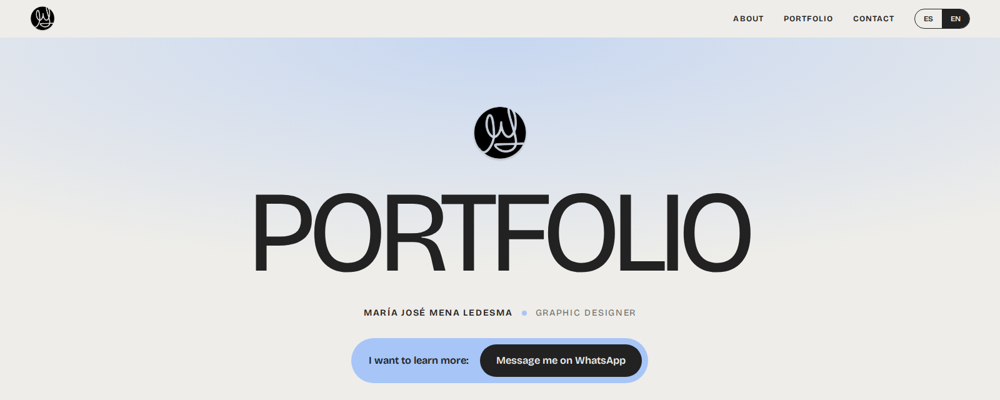
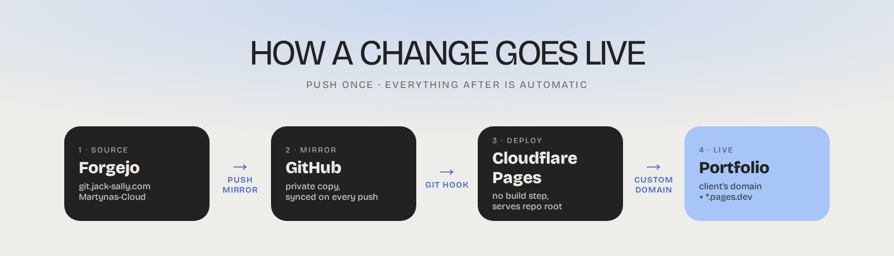

# María José Mena Ledesma · Portfolio

Static one-page portfolio (ES/EN). Plain HTML/CSS/JS, no build step.

| Path | What |
|---|---|
| `index.html` | the page |
| `css/style.css` | styles (light + dark) |
| `js/main.js` | ES/EN texts, projects, carousels |
| `assets/img/` | photos, logos, icons |
| `LEEME.txt` | the same layout notes in Spanish, for whoever hosts it by hand |

Fonts (Bricolage Grotesque) load from Google Fonts.

## How a change goes live

1. Commit and push to `main` on Forgejo (`Martynas-Cloud/menaledesma-portfolio`), the source of truth.
2. Forgejo's push mirror copies it to the private GitHub repo on every push.
3. Cloudflare Pages deploys from GitHub: framework **None**, build command empty, output directory `/`.

Never commit to the GitHub copy directly; the mirror overwrites it.

Local preview: `python3 -m http.server 8000` in the repo root.

README art: `docs/readme/src/` (re-render from the repo root with `NODE_PATH=~/koda/node_modules node docs/readme/src/render.cjs`; Playwright must resolve).
